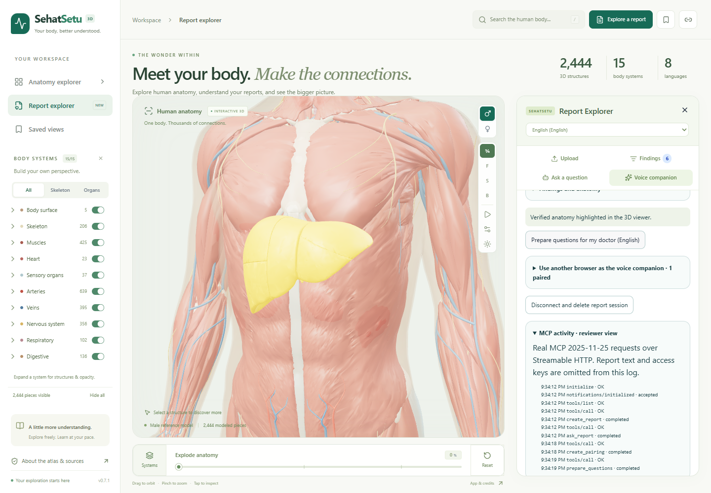
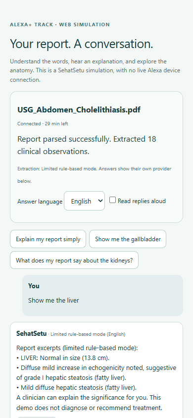
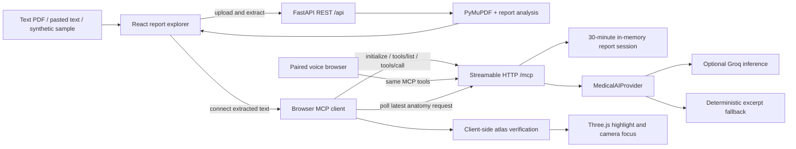
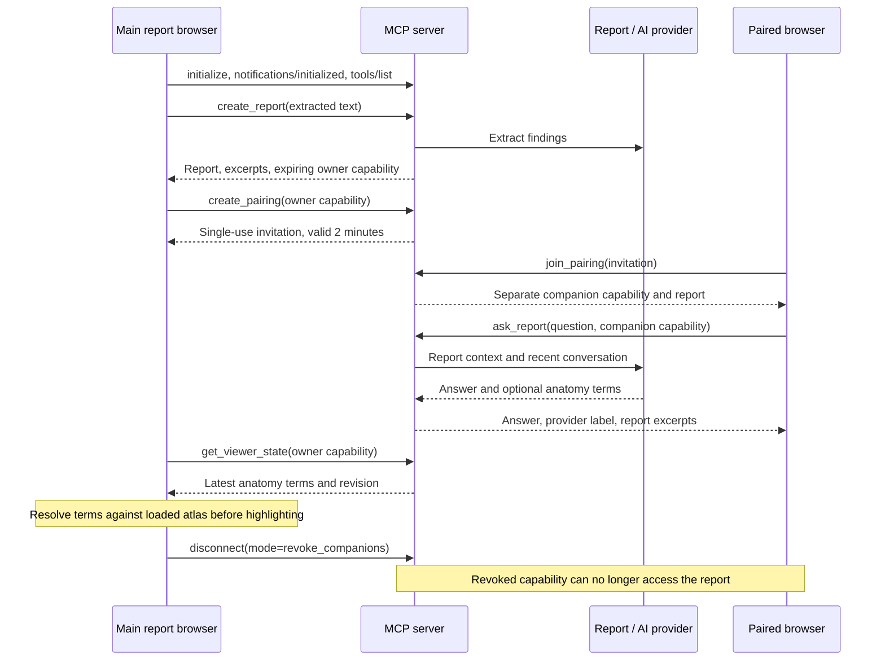

<div align="center">
  
  <h1>SehatSetu</h1>
  <p><strong>Your medical report. A conversation you can understand.</strong></p>
  <p>A voice-first medical report companion for the Alexa+ track.</p>
  <p><a href="https://www.youtube.com/watch?v=teRzrT49HVo">Watch the team demo</a> · <a href="docs/hackathon/JUDGE_GUIDE.md">Judge's guide</a> · <a href="#architecture">Architecture</a> · <a href="docs/hackathon/TECHNICAL_REVIEW.md">Inspect the implementation</a></p>
</div>

**Amazon Build, Ship, Shape Developer Hackathon · Alexa+ primary track**

Implementation: **a clearly labeled Alexa+ web simulation backed by a real self-hosted MCP server**. No Echo hardware, Alexa account, or gated SDK is required. This independent prototype does not connect to a live Alexa device.

> **Version transparency:** The MCP server, companion simulation, pairing, and documentation in this working copy were added on **October 25, 2026, after the submission deadline**. They describe the current project, not proof of what existed in the submitted video or deadline version. See [development history and submission status](docs/hackathon/SUBMISSION_STATUS.md).

## Start here, judges

**Choose your review path:** [five-minute evaluation with expected results](docs/hackathon/JUDGE_GUIDE.md), [full documentation index](docs/hackathon/README.md), or [setup troubleshooting](docs/hackathon/TROUBLESHOOTING.md). No login, Alexa hardware, AWS account, or paid API key is needed for the core walkthrough.

1. Follow [Run locally](#run-locally), then open **[the demo](http://localhost:3016/?demo=1)**.
2. In **Upload**, choose the first synthetic sample, **Abdominal Ultrasound**. Its filename ends in `.pdf`, but this sample uses embedded text; no PDF download is needed.
3. Open **Voice companion** → **Connect report to assistant**.
4. Select **Show me the gallbladder**. Compare the response with the report excerpts and watch verified anatomy highlight in the 3D viewer.
5. Try **What does my report say about the kidneys?**, then **Prepare questions for my doctor**.
6. Expand **MCP activity · reviewer view** to inspect real tool activity. Run `python -m backend.smoke_mcp` for an independent official-SDK client check.

**No API key is needed for this walkthrough.** Without Groq, extraction is rule-based and answers show matching report excerpts in English. Natural conversational explanations, follow-ups, and translation require a working `GROQ_API_KEY`. Each answer identifies the provider actually used, including fallback after a failed AI request.

## Demo video and screenshots

**[Watch the team-provided demo on YouTube](https://www.youtube.com/watch?v=teRzrT49HVo).** The video is supplied by the team; its footage, runtime, and correspondence to the deadline version have not been independently verified. The walkthrough below documents the current runnable code.

| Desktop: shared anatomy and MCP activity | Mobile: paired report conversation |
| --- | --- |
|  |  |

Screenshots are from the current local implementation using a synthetic report. Anatomy source attribution and applicable licenses are listed in [asset attribution](public/ATTRIBUTION.md).

## The experience

Patients and caregivers often struggle to connect report terminology with understandable anatomy. SehatSetu links report text, spoken interaction, and a shared visual surface before a conversation with their clinician.

**Upload once → ask by voice or text → hear an explanation → check report evidence → locate anatomy.**

- Upload a text-based PDF, paste report text, or choose one of three synthetic samples.
- Discuss the selected report through a temporary session; the AI path receives recent conversation context for follow-ups.
- Select English, Hindi, Bengali, Telugu, Marathi, Tamil, Gujarati, or Kannada. Browser microphone support and installed voices vary.
- Ask about an organ or select **Show anatomy** beside a finding. Only structures verified against the loaded atlas can be highlighted.
- Prepare English discussion prompts anchored to report phrases.
- Pair a second browser as a voice companion while the main browser displays the 3D atlas.

The 3D body is **normal reference anatomy**, not a reconstruction of the patient's scan. Highlighting an organ does not establish disease. This educational prototype does not diagnose, prescribe, or replace clinical care.

## Why the Alexa+ track fits

The official rules allow simulated Alexa+ web experiences. The FAQ explicitly accepts a web page sending real MCP initialization, tool discovery, and tool calls over Streamable HTTP. This implementation follows that route using its own browser UI and the official MCP Python SDK.

The browser controller routes questions to `ask_report`; explicit actions invoke anatomy, preparation, and pairing tools. It does not claim autonomous model-driven tool selection or an Amazon-certified integration.

Sources: [official rules](https://amazonappdev2026.devpost.com/rules), [Alexa+ simulator FAQ](https://amazonappdev2026.devpost.com/details/faqs).

The track connection is concrete: voice input and read-aloud make reports approachable, a companion screen adds visual context, and a standards-based tool surface lets an assistant client invoke the same report workflow. The prototype demonstrates these interactions through a browser simulator. A future approved Alexa+ host could use the MCP surface after its separate integration and authorization requirements are met.

| Judging dimension | What to evaluate here | Evidence |
| --- | --- | --- |
| Technical implementation | Actual protocol negotiation, discoverable tools, report sessions, verified anatomy navigation | [Independent MCP check](backend/smoke_mcp.py), [protocol tests](backend/test_mcp.py) |
| Design | One flow from report to question, excerpt comparison, spoken reply, and visual location | [Judge's guide](docs/hackathon/JUDGE_GUIDE.md), screenshots above |
| Potential impact | Helping patients and caregivers prepare for an informed clinical conversation | [User scenario and limits](docs/hackathon/JUDGE_GUIDE.md#user-scenario) |
| Quality of the idea | Combining conversation and a shared visual context with explicit companion-device handoff | [Architecture and interaction sequence](#architecture) |

These are evaluation pointers, not measured clinical outcomes or a prediction of judging results.

## Run locally

Prerequisites: **Node.js 22.18+**, **Python 3.11+**, and a browser with WebGL 2. Start in the repository root and use two terminals.

**Terminal 1 — backend and MCP server**

```sh
python -m venv .venv
```

Activate it on Windows PowerShell:

```powershell
.\.venv\Scripts\Activate.ps1
```

Or on macOS / Linux:

```sh
source .venv/bin/activate
```

Then:

```sh
python -m pip install -r backend/requirements.txt
python -m uvicorn backend.main:app --host 127.0.0.1 --port 8000
```

**Terminal 2 — browser app**

```sh
npm ci
npm run dev
```

Open **[http://localhost:3016/?demo=1](http://localhost:3016/?demo=1)**. Vite proxies `/api` and `/mcp` to port 8000. Health endpoint: [http://127.0.0.1:8000/api/health](http://127.0.0.1:8000/api/health). MCP endpoint: `http://127.0.0.1:8000/mcp`.

For AI explanations, copy [backend/.env.example](backend/.env.example) to `backend/.env`, set `GROQ_API_KEY`, and restart the backend. Keep keys on the server. The example also documents allowed host/origin settings. Set `SEHATSETU_API_TARGET` before launching Vite to override the backend URL if necessary.

## Separate-browser voice companion

Expand **Use another browser as the voice companion**, create an invitation, open its private link in a second tab, and choose **Join report session**. Ask **Show me the liver** there; the original viewer receives the request and verifies anatomy locally.

For another physical device, serve both frontend and backend behind the **same reachable HTTPS origin**, forwarding `/api/*` and `/mcp` to the backend. Add its exact origin to `SEHATSETU_ALLOWED_ORIGINS` and hostname to `SEHATSETU_ALLOWED_HOSTS`; run **one backend worker**. Localhost links only work on the same computer. Microphone input requires localhost or HTTPS and browser permission.

Invitations grant report access, expire after two minutes, and work once. They use a URL fragment, removed by the companion immediately. Companion capabilities are separate from the owner's. Revoke companions or delete the report session from the owner browser. Sessions last 30 minutes and do not survive backend restarts.

## Architecture





| MCP tool | Purpose |
| --- | --- |
| `create_report` | Analyze text and issue an expiring session capability |
| `get_report` | Read the session's summary, findings, and excerpts |
| `ask_report` | Answer with report context and recent history; optionally request anatomy navigation |
| `focus_anatomy` | Locate anatomy associated with an existing finding |
| `prepare_questions` | Create English clinician-discussion prompts from report phrases |
| `get_viewer_state` | Poll anatomy requests, connection count, and expiry |
| `create_pairing` / `join_pairing` | Create and consume single-use invitations |
| `disconnect` | Delete a report, leave a session, or revoke companions |

Transport: **MCP 2025-11-25, Streamable HTTP in JSON response mode**, official SDK pinned to `mcp==1.30.0`. Transport is stateless; bounded application sessions retain report/conversation state. External MCP clients can use the same tools. Demo access uses session capabilities in tool arguments, not production OAuth identity.

Key files: [MCP server](backend/mcp_server.py), [FastAPI entry point](backend/main.py), [browser MCP client](app/report-mcp-client.ts), [companion UI](app/voice-companion.tsx), [atlas verification](app/medical-mapping.ts). See the [architecture review](docs/hackathon/TECHNICAL_REVIEW.md) for data boundaries, source-level evidence, tool inputs, and limitations. The [atlas technical guide](README-technical.md) preserves viewer internals and asset provenance.

The current architecture runs in the browser and one Python backend process. It does not use Bedrock, Lambda, S3, DynamoDB, or a live Alexa endpoint. These services are not prerequisites for the track's simulated-experience route. Proposed Amazon deployment work is kept separate in the [future integration plan](docs/hackathon/TECHNICAL_REVIEW.md#future-amazon-integration-not-implemented).

## Verification

With the Python environment active:

```sh
python backend/test_backend.py
python -m unittest backend.test_mcp -v
python -m backend.smoke_mcp   # backend must be running on port 8000
npm run check
npm run lint
npm test
npm run build
npx playwright install chromium
npm run test:companion
```

The companion browser check starts its own backend on **8011** and frontend on **4318**. It checks sample loading, actual MCP calls, report answers, anatomy navigation, paired browsers, mobile layout, and revocation, with no paid inference. Set `PYTHON` if your virtual environment lives elsewhere.

## Prototype boundaries and data

- Use synthetic or de-identified reports. Groq receives report/chat context when configured. Browser speech recognition may send audio to its vendor's service.
- Sessions are process-local, capped at 64 reports, with 30-minute access expiry. A background sweep removes expired entries every 30 seconds. Explicit disconnect deletes a session immediately.
- Request bodies are limited to 10 MiB; MCP report text to 100,000 characters. Model extraction uses up to 12,000 report characters; report chat includes up to 4,000 report characters plus recent history. Shorten long documents for this prototype.
- Scanned PDFs require OCR, which is not implemented. MCP analysis uses extracted text and does not retain original PDF page positions. Excerpts are comparison evidence, not verified sentence-level citations for generated prose.
- Deterministic extraction can miss or misclassify findings. Always compare the original report. Translation and conversational follow-ups require the AI path.
- The cached atlas/PWA can work offline; the MCP companion needs the backend. GitHub Pages cannot run this Python service.
- Physical Alexa integration, durable patient storage, production authentication, clinical validation, and Amazon marketplace deployment are outside this prototype.

## Hackathon materials

- [Documentation index](docs/hackathon/README.md)
- [Five-minute judge's guide and expected results](docs/hackathon/JUDGE_GUIDE.md)
- [Detailed architecture and implementation evidence](docs/hackathon/TECHNICAL_REVIEW.md)
- [Setup and demo troubleshooting](docs/hackathon/TROUBLESHOOTING.md)
- [Short demo walkthrough](docs/hackathon/DEMO_WALKTHROUGH.md)
- [Product feedback and observed friction](docs/hackathon/PRODUCT_FEEDBACK.md)
- [Submission status, development history, and eligibility checks](docs/hackathon/SUBMISSION_STATUS.md)
- [Recorded verification and test boundaries](docs/hackathon/VERIFICATION.md)

AWS Builder requires actual qualifying AWS/tool use during the event; this implementation uses Groq and makes no AWS Builder claim. Open Source requires a qualifying contribution, timing, and required URLs; the license alone does not establish eligibility. These documents do not establish eligibility for later work.

## Credits and licenses

SehatSetu builds on [ashemag/human-atlas](https://github.com/ashemag/human-atlas), Anatolume, and the contributors detailed in the [technical guide](README-technical.md#credits). Their viewer and asset-pipeline work should not be presented as newly authored hackathon functionality.

Application code: [MIT](LICENSE), retaining the original notice. BodyParts3D and HRA assets: CC BY 4.0. Z-Anatomy adaptations and combined catalogues: CC BY-SA 4.0. Preserve source attribution and applicable share-alike requirements. Full details: [asset attribution](public/ATTRIBUTION.md).
