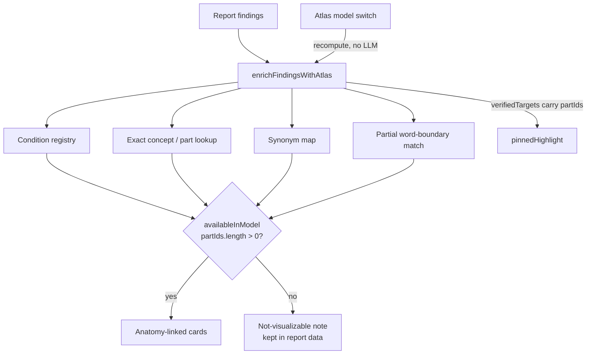
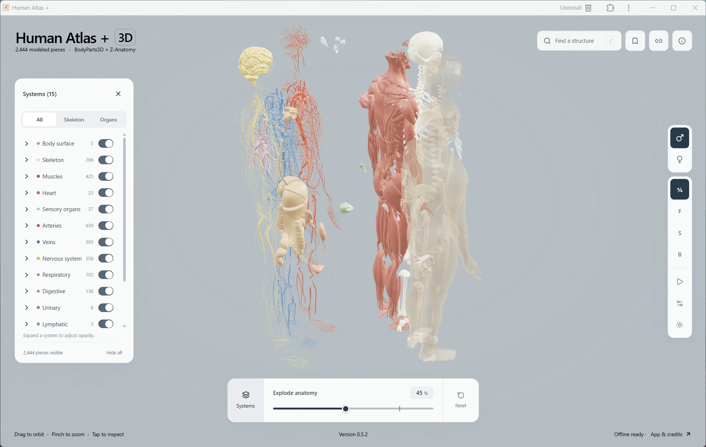
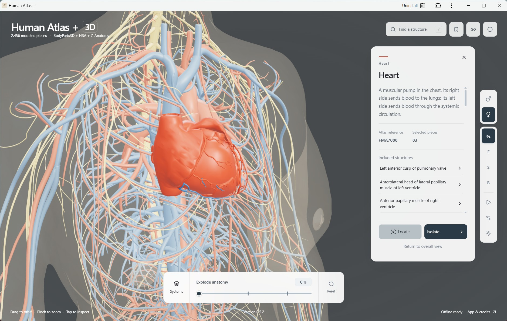
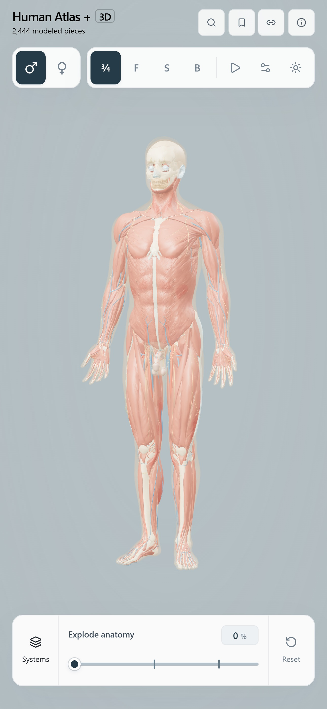
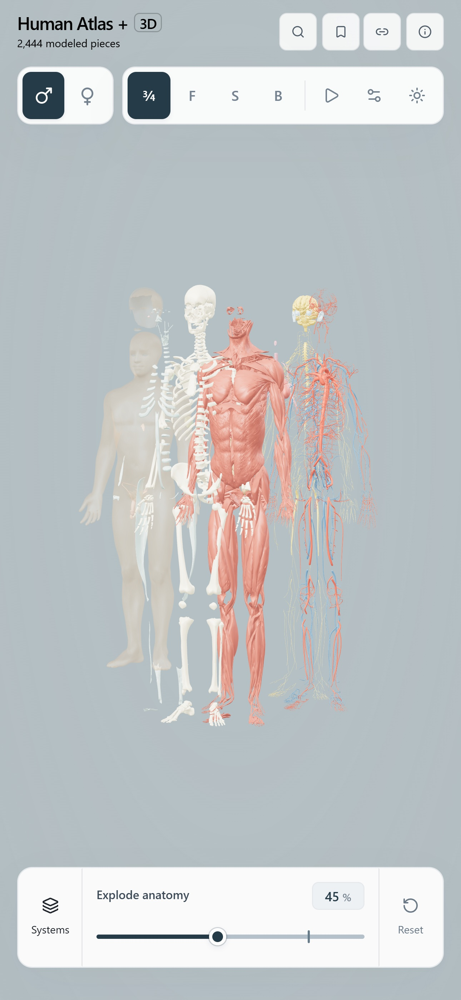
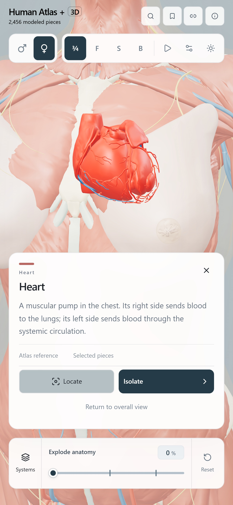
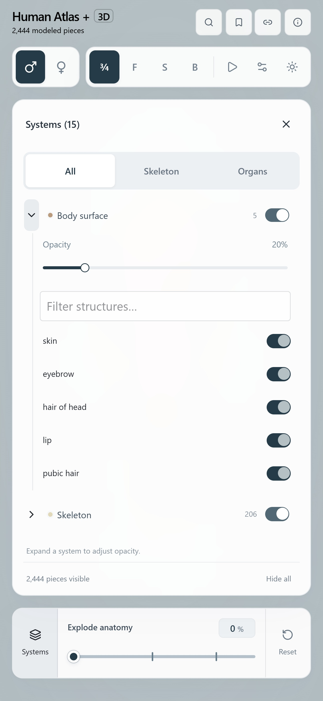

<div align="center">


# Human Atlas + × SehatSetu

<p>
  <a href="https://github.com/llm-junkie/ha/actions/workflows/deploy-pages.yml"></a>
  <a href="LICENSE"></a>
  <a href="public/ATTRIBUTION.md"></a>
  <a href="#install-and-use-offline"></a>
</p>

Interactive 3D anatomy for phones, tablets and desktops — now with **SehatSetu**, a
multilingual medical-report explorer that maps extracted clinical findings to verified
3D structures and answers questions by voice in the user's language.

**Free · Works offline · No account required**

<br>

Installation: [iPhone / iPad](#install-on-iphone-or-ipad) · [Mac](#install-on-mac) · [Android](#install-on-android) · [Windows](#install-on-windows) · [Linux](#install-on-linux)

</div>

---

## Contents

1. [Overview](#overview)
2. [Tech stack](#tech-stack)
3. [Setup and commands](#setup-and-commands)
4. [Environment variables](#environment-variables)
5. [Project structure](#project-structure)
6. [Viewer features (Human Atlas+)](#viewer-features-human-atlas)
7. [SehatSetu: medical report explorer](#sehatsetu-medical-report-explorer)
   - [PDF upload and report analysis](#pdf-upload-and-report-analysis)
   - [Clinical finding cards](#clinical-finding-cards)
   - [Persistent highlight systems](#persistent-highlight-systems)
   - [AI-assisted anatomy location](#ai-assisted-anatomy-location)
   - [Persistence rules (explode / camera / isolation)](#persistence-rules-explode--camera--isolation)
   - [Per-finding chat and voice](#per-finding-chat-and-voice)
   - [Availability filtering](#availability-filtering)
   - [Find a Structure + structure chatbot](#find-a-structure--structure-chatbot)
8. [Language pipeline](#language-pipeline)
9. [Voice input and output](#voice-input-and-output)
10. [Architecture](#architecture)
11. [API reference](#api-reference)
12. [Anatomy catalogue and mesh ID conventions](#anatomy-catalogue-and-mesh-id-conventions)
13. [Language and voice support matrix](#language-and-voice-support-matrix)
14. [Tests and validation](#tests-and-validation)
15. [Known limitations and troubleshooting](#known-limitations-and-troubleshooting)
16. [Extending the project](#extending-the-project)
17. [Viewer internals, PWA, data and credits](#viewer-internals-pwa-data-and-credits)

---

## Overview

Human Atlas+ is an offline-capable PWA anatomy explorer built on React + Three.js.
Male (BodyParts3D + Z-Anatomy) and experimental female (BodyParts3D + HRA + Z-Anatomy)
models contain thousands of individually selectable meshes with named concepts.

**SehatSetu** ("health helpdesk") extends the atlas with a medical-report surface:

- Upload a PDF / paste or load sample clinical reports.
- Deterministic + Groq-LLM extraction into structured findings (negation, laterality,
  certainty, measurements preserved).
- Each finding is mapped, in the browser, to **verified mesh IDs in the currently loaded
  catalogue** — conditions map to organs, organs map to real, renderable parts.
- Findings highlight their anatomy in yellow which persists across camera flight,
  exploded view and isolation; a lock keeps it pinned.
- A contextual, scoped AI chat (report, per-finding, per-structure, location) answers
  in the user's language — English, Hindi, Bengali, Telugu, Marathi, Tamil, Gujarati,
  Kannada — with voice input and read-aloud matched to the response language.

This is an educational reference for understanding terminology and anatomy. It does not
diagnose or recommend treatment.

## Tech stack

| Layer | Technology |
| --- | --- |
| UI | React 19.3, @base-ui/react, lucide-react, Tailwind CSS 4 |
| 3D | Three.js 0.186 (WebGL 2), custom batched mesh renderer |
| Build | Vite 8, TypeScript 7 (type-only checking), oxlint, Playwright |
| PWA | Custom service worker (`app/service-worker.js`) + build plugin |
| Backend | Python 3, FastAPI, Pydantic, httpx, PyMuPDF |
| AI | Groq chat-completions API (`openai/gpt-oss-120b` default, dynamic model discovery) |
| Voice | Browser Web Speech API (SpeechRecognition + SpeechSynthesis) |

## Setup and commands

```sh
npm ci            # install front-end dependencies (Node ≥ 22.18, see .nvmrc)
npm run dev       # http://localhost:3016 (proxies /api to the backend)
npm run server    # FastAPI backend on http://127.0.0.1:8000
npm run check     # tsc --noEmit
npm run lint      # oxlint (warnings are errors)
npm test          # atlas/interaction/PWA validation + node --test scripts/*.test.mjs
npm run build     # production build into dist/ (then validates the PWA build)
npm run test:browser  # Playwright suite against a production build under /ha/
```

Backend Python dependencies: `pip install -r backend/requirements.txt`
(fastapi, uvicorn, pydantic, httpx, python-dotenv; see that file).

The front-end works without the backend: `analyzeReport` and `sendChatMessage`
transparently fall back to a local deterministic pipeline. With the backend running
and `GROQ_API_KEY` configured, extraction and chat use Groq.

## Environment variables

| Variable | Where | Purpose |
| --- | --- | --- |
| `GROQ_API_KEY` | `backend/.env` or environment | Enables Groq-backed extraction and chat. Missing key ⇒ deterministic local pipeline. |
| `GROQ_MODEL` | backend | Preferred chat/extraction model id (default `openai/gpt-oss-120b`). If a model id 404s, the provider auto-discovers an available chat model. |
| `GROQ_BASE_URL` | backend | Overrides the Groq endpoint default (`https://api.groq.com/openai/v1`). |
| `PROVIDER_TIMEOUT_SECONDS` | backend | Outbound LLM call timeout (default 35 s). |

The `.env` in the repo root is loaded for the backend; a `backend/.env` file is loaded
as well. Frontend voice UI does not need keys (Web Speech API is local to the browser).

## Project structure

```
app/                        React application (the atlas + SehatSetu UI)
  page.tsx                  Main viewer page: layout, systems, search, detail sheet,
                            model switch, mounts MedicalReportExplorer
  scene.tsx                 Three.js scene: batched meshes, explode layout, camera
                            transitions, selection/highlight overlay (pinnedHighlight)
  anatomy.ts                Atlas/SceneState types, SYSTEMS palette, defaults
  anatomy-search.ts         Search concepts + aliases + muscle groups
  medical-report-explorer.tsx   SehatSetu panel: tabs (Upload / Findings / Chat),
                            highlight toolbar, report chat, availability split
  medical-report-service.ts PDF/text analysis pipeline, local deterministic
                            extraction, scoped chat service (contextType contract)
  medical-mapping.ts        5-tier anatomy resolution (condition registry, synonyms,
                            concept/part lookup) + availability helper functions
  medical-language.ts       Per-message response-language resolution
  medical-types.ts          Findings, verified targets, languages, chat message types
  medical-i18n.ts           UI dictionaries for all 8 languages
  medical-audio.ts          MedicalAudioController: speech recognition + synthesis
  medical-scoped-chat.tsx   ScopedChat component (per finding / per structure chat)
  medical-anatomy-controller.ts Baseline capture/restore, focus/focus-all/isolate
  anatomy-material.ts, layer-opacity.ts, part-visibility.ts, explosion-layout.ts,
  draw-batches.ts, frame-scheduler.ts, pointer-tap.ts, wheel-zoom.ts, anchored-pan.ts,
  camera-pose.ts, saved-views.ts, model-download.ts, model-catalogue.ts, pwa*.ts
backend/
  main.py                   FastAPI app: /api/health, /api/reports/analyze, /api/chat
  provider.py               Groq extraction + chat prompts, model discovery,
                            deterministic fallbacks, scoped context blocks
  models.py                 Pydantic request/response schemas
  pdf_extractor.py          PDF text extraction + scanned-PDF detection
  test_backend.py           Backend integration tests (health, analyze, chat)
web/                        Vite entry HTML and locale files
public/models/              atlas.json + atlas-female.json + 38 model chunks (.js/.gz)
scripts/                    Asset pipeline and tests (sehatsetu-medical.test.mjs, etc.)
data/                       Source conversion inputs
docs/                       Model notes (female model, skin, nerves, classification)
```

## Viewer features (Human Atlas+)

All viewer behavior below is unchanged by SehatSetu:

- **Orbit / zoom / pan** — OrbitControls with damped rotation, cursor-anchored zoom,
  body-anchored pan; right-drag/one-finger pan in the exploded inventory.
- **Systems layers** — toggle anatomical systems, expand a row to fade opacity 5–100%,
  body-surface default 20%, presets (skeleton/organs), per-structure switches.
- **Exploded view** — slider builds a spaced inventory of visible pieces, snapping at
  45% and 79%; visibility/selection stay cached during the animation; **Reset**
  restores the assembled view.
- **Selection & detail sheet** — tap a mesh (tap-vs-drag discrimination) to select;
  hue preserved with doubled saturation and −25% lightness. The detail sheet shows
  name, description, member pieces, source links, and Locate/Isolate actions.
- **Locate / Log isolation** — *Locate* frames the structure through surrounding
  anatomy with a depth pass; *Isolate* dims/hides surroundings; *Surroundings* restores
  them. Isolation restores prior visibility rather than blanket-showing everything.
- **Search ("Find a Structure")** — name / alias / ID / muscle-group matching, up to
  80 results, recent structures remembered per model.
- **Saved views & share links** — up to 20 named bookmarks per model; view links carry
  camera, selection, layers and explosion percentage.
- **Language-unaffected 3D state** — switching languages never rebuilds scene or materials.

## SehatSetu: medical report explorer

### PDF upload and report analysis

User flow — Upload tab → drag & drop (or picker, paste text, or 3 sample reports) →
progress bar through extract / analyze / map stages → findings tab opens.

1. The file (or text) posts to `POST /api/reports/analyze` (multipart, 45 s client
   timeout). The backend extracts PDF text with PyMuPDF (page-by-page, reading order
   preserved; detects scanned/image PDFs and rejects them with a clear error), then
   asks Groq for structured findings. On any provider failure it falls back to a deterministic
   rule-based extractor that still preserves negation, laterality, certainty, and
   measurement (value + unit).
2. The browser then **re-verifies every anatomical mention against the loaded atlas**
   (`enrichFindingsWithAtlas` in [medical-mapping.ts](app/medical-mapping.ts)) — the
   LLM's `catalogue_mapping_status` is never trusted blindly. Verified targets carry
   real `partIds` of the currently loaded model. 5-tier resolution:
   curated condition registry → exact concept → synonyms → condition→organ mapping →
   partial word-boundary match; otherwise an unresolved/unavailable record.
3. Offline (backend unreachable): the browser reads text-extractable PDFs itself and
   runs the same deterministic extractor; sample reports always work.

### Clinical finding cards

Each card shows the term, status badge (Confirmed / Suspected / Ruled Out),
plain-language explanation, verified-target pills ("Verified in 3D Atlas" /
"Condition Associated" / "Not Available in Model"), the quoted evidence phrase, and
consecutive actions:

- **Focus in 3D** — flies the camera to the primary verified target and (with highlight
  locked) pins the yellow highlight on it.
- **Ask AI (per-card chat)** — see [Per-finding chat](#per-finding-chat-and-voice).

Tapping a card selects its targets; clicking any 3D structure updates the inspected-
organ context card (which shows report findings for that organ, or the fact that it is
normal reference anatomy — never implying disease).

### Persistent highlight systems

Highlights are implemented in one place ([scene.tsx](app/scene.tsx)) as a
field-of-view overlay group (`contextHighlight`) driven by the union of
`state.selected` and `state.pinnedHighlight`. This is the single source of truth:

- **Selection highlight** — regular atlas selection persists until the detail sheet
  closes or another structure is selected.
- **Hover** — pointer-name tooltip only; it never mutates selection.
- **Locked/pinned highlight (`pinnedHighlight`)** — report-driven persistent yellow
  highlight. It survives React renders, camera flights, explosion updates and
  isolation because the overlay position is recomputed from the live offset buffers
  every animated frame, and the overlay key only changes when the ID set changes.
- **Highlight All Structures** — highlights every *verified, actually-present* target
  in the report (`visualizableFindings`), ignoring invalid IDs safely, and never
  reports success when zero targets resolved. The toolbar `Highlight: LOCKED/OFF`
  button pins (all findings or the active one) or clears the pin.
- **Highlight Anatomy / inspected-organ pin** — per-structure pin from the inspected
  card; repeated clicks toggle without creating duplicate objects (an overlay-keyed
  group replace, reusing cached locate materials per system).

Material safety: the overlay reuses one locate material per system created once;
original meshes/materials are never mutated; only the overlay meshes are added or
removed; disposal on teardown follows the overlay group.

### AI-assisted anatomy location

Ask e.g. *"Show me the gallbladder"* (any language). The reply's `mentioned_terms` are
resolved **client-side against the catalogue**: only verified IDs enter selection
state; free-form output can never touch arbitrary meshes. The camera flies to the
first verified target and stays highlighted (selection highlight + pinned highlight
when locked). If the term cannot be verified in the loaded model the app says so
("Not available in model" pill) and does not navigate.

### Persistence rules (explode / camera / isolation)

- Camera transitions never clear selection — Animated target/position transitions
  only move the camera.
- Exploded-view updates are transform-only (`data[i*4..]` offset buffers); the
  highlight overlay follows the same offsets per frame, so the correct piece stays
  highlighted at every explosion percentage.
- Isolation (from the medical controller) preserves the current selection/pinned
  highlight; `restoreBaseline` returns the viewer to its pre-report state exactly,
  including previously hidden structures.

### Per-finding chat and voice

Every finding card contains a scoped chat (`ScopedChat` in
[medical-scoped-chat.tsx](app/medical-scoped-chat.tsx)):

- One **private history per finding**, opened/closed inline without affecting others.
- Context passed to the backend: `contextType: "finding"`, `finding_id`, the finding
  term + evidence quote, plus the report text for grounding (explicitly scoped:
  "use only when answering about this finding").
- Mic button, interim-transcript input, submit; replies read aloud with speech matched
  to the **actual response language** of the message, with a stop control and overlap
  prevention (new speech cancels old).
- Requests carry a sequence number and an aliveness guard, so a late reply never lands
  in a different card or after another scope replaced the chat.
- Language: user may select a chat language; the component also renders the selected
  panel language; per-message language is always resolved from the message itself.

### Availability filtering

A finding appears in the anatomy-linked card list **only if** it has ≥1 verified
target whose `partIds` exist in the loaded model (`isVisualizableFinding` /
`splitFindingsByAvailability` in [medical-mapping.ts](app/medical-mapping.ts)).

- No "nearest-structure" substitution, no fabricated meshes.
- Non-visualizable findings are preserved in the full report data and summarized in a
  compact "Not visualizable in this model (n): …" note at the end of the list.
- Switching atlas models recomputes the mapping from the stored extracted findings
  (`useMemo([reportState.result, atlas])`) — no LLM re-analysis, no stale cross-model
  caches.

### Find a Structure + structure chatbot

The atlas detail sheet (opened from search or by clicking anatomy) contains an
**"Ask AI about this structure…"** scoped chat, independent of any report:

- Works with or without an active report; `contextType: "structure"` passes structure
  ID, canonical name, verified aliases, and catalogue description when available.
- The backend prompt labels catalogue facts as catalogue knowledge and general
  statements as general education; selection never implies disease; no diagnosis.
- Its own language selector; languages can be switched mid-conversation; follow-ups
  keep the structure context; switching structures resets the private history
  (stale replies cannot leak across structures).

## Language pipeline

Supported UI + chat languages: **English, Hindi, Bengali, Telugu, Marathi, Tamil,
Gujarati, Kannada** (`SUPPORTED_LANGUAGES` in [medical-types.ts](app/medical-types.ts)).
The selector is unchanged and drives UI strings ([medical-i18n.ts](app/medical-i18n.ts))
and speech-locale tags.

Per-message response language ([medical-language.ts](app/medical-language.ts)):

1. **Explicit instruction in the message wins** — "Answer in Hindi", "Explain in
   Tamil", native-language requests ("हिंदी में बताओ").
2. **Otherwise detect the script** — Bengali/Telugu/Marathi/Tamil/Gujarati/Kannada/
   Devanagari (Devanagari maps to Hindi, or Marathi when that is the selected
   preference). English medical terms inside an Indic-script message do not flip the
   result to English (code-switching keeps the dominant language).
3. **Short/ambiguous/transliterated input uses the selected language** — typing
   `gallstone` as a Hindi user stays Hindi.
4. The resolved code is sent as `response_language` on every `/api/chat` request
   (structured field, not guessed from a showable label), and attached to the
   assistant `ChatMessage` for TTS.

Groq system prompt requires: answer in the resolved language, continue in it until the
user changes, keep useful English medical terms but explain them in the response
language, use the dominant language for mixed input, never switch to English because
the report is English, and keep report evidence separate from general education.
Extraction prompts also request the summary/explanations in the configured language
and never alter stored report text to determine language.

## Voice input and output

- **Recognition** (`MedicalAudioController.startListening`): browser SpeechRecognition
  with the selected language's `speechTag` (e.g. `hi-IN`), interim transcript shown,
  final transcript auto-submits. Graceful handling of unsupported browsers and denied
  mic permission; typed chat always remains available. Recognition never auto-starts.
- **Synthesis** (`speak`): cancels previous utterances first (no overlap), strips
  markdown artifacts, selects voices with a best-match strategy per language
  (exact locale → language prefix → Indian-English/India-named voice fallback), sets
  `utterance.lang` from the **response** language, includes a Chrome 15-second pause
  workaround. If no voice for the language exists, the text reply still shows and the
  UI keeps working (English fallback voice is used on many systems).
- Read-aloud exists on: report chat messages, per-finding chats, per-structure chats.

## Architecture

### Selection / highlight pipeline

```mermaid
graph TD
  subgraph Sources
    A[Tap on mesh] -->|parts[id]| S[state.selected]
    B[Finding card / Highlight All / AI locate] -->|verified partIds| P[state.pinnedHighlight]
    C[Highlight lock toggle] --> P
  end
  S --> K{every animated frame}
  P --> K
  K -->|only when ID set changed| O[contextHighlight overlay group<br/>yellow locate materials]
  K -->|every frame| M[position sync with explode offsets]
  O --> R[depth pass render behind/through surroundings]
```

- Hover is transient (tooltip only) and can never clear selection.
- Multiple highlight sources merge; removing one (unlock) does not erase selection.
- No timers, no second render loop, one overlay rebuild per ID-set change.

### Chat / context pipeline

```mermaid
graph TD
  R[Report chat] -->|contextType report<br/>report text + selection| F[sendChatMessage]
  FC[Finding card chat] -->|contextType finding<br/>finding id/term/evidence| F
  SC[Structure chat] -->|contextType structure<br/>id/name/aliases/description| F
  AI[AI locate ask] -->|contextType location| F
  F --> Lang[resolveResponseLanguage<br/>explicit &gt; script &gt; selected]
  F -->|POST /api/chat| GP[FastAPI + Groq<br/>scoped context block]
  GP -->|JSON {answer, mentioned_terms, ...}| F
  F -->|language pinned on reply| TTS[SpeechSynthesis voice=reply language]
  AI -->|mentioned_terms checked against catalogue| Nav[selection + camera flight]
```

### Finding-to-anatomy mapping & availability



## API reference

Base URL: `http://127.0.0.1:8000` (dev proxy `/api` ⇒ backend). All request bodies are
JSON except where noted. CORS is open for development.

### `GET /api/health`

```json
{ "status": "healthy", "provider": "groq",
  "model": "openai/gpt-oss-120b", "groq_api_key_configured": true, "version": "1.0.0" }
```

### `POST /api/reports/analyze`

Multipart form: `file` (PDF, optional), `text` (optional), `language` (form string).
Errors: `400` empty upload / non-PDF-non-text / insufficient text, `400` scanned or
encrypted PDF (with actionable message).

Response (`ReportAnalyzeResponse`):

```json
{
  "report_id": "rep-1730000000000",
  "filename": "USG_Abdomen.pdf",
  "extracted_text": "…",
  "page_count": 1,
  "summary": "…",
  "findings": [
    {
      "finding_id": "f-1",
      "term": "gallstones",
      "report_phrase": "12 mm calculus …",
      "condition": "cholelithiasis",
      "observation": "…",
      "anatomical_location": "gallbladder",
      "laterality": "unspecified",
      "negation": "present | absent | ruled_out",
      "certainty": "confirmed | suspected | possible | indeterminate | not_stated",
      "temporal_context": "current | historical | comparison",
      "measurement": { "value": 12, "unit": "mm" },
      "source": { "page": 1, "evidence_text": "…" },
      "explanation": "…",
      "anatomical_mentions": [
        { "term": "gallbladder", "laterality": "unspecified",
          "catalogue_mapping_status": "verified" }
      ],
      "warnings": []
    }
  ],
  "unmapped_terms": [],
  "disclaimer": "…", "created_at": "…",
  "provider": "groq", "model": "openai/gpt-oss-120b"
}
```

The front-end additionally attaches `verifiedTargets[]` to each finding after
catalogue resolution (not produced by the backend alone).

### `POST /api/chat`

Request (`ChatRequest`). `context_type` selects the scoped context block:

```json
{
  "question": "Iska matlab kya hai?",
  "report_context": "…≤4000 chars…",
  "language": "hi",
  "preferred_language": "hi",
  "response_language": "hi",
  "context_type": "report | finding | structure | location",
  "finding_id": "finding-3",
  "finding_term": "gallstones",
  "finding_evidence": "Single echogenic focus measuring 12 mm …",
  "structure_id": "FMA7202",
  "structure_name": "gallbladder",
  "structure_aliases": ["gall bladder"],
  "structure_description": "…",
  "history": [{ "sender": "user", "text": "…" }],
  "selected_organ": "gallbladder",
  "current_finding": "gallstones",
  "session_id": "sess-1730000000000"
}
```

Response (`ChatResponse`):

```json
{
  "answer": "…in the resolved response language…",
  "mentioned_terms": ["gallbladder"],
  "navigation_intent": true,
  "warnings": [],
  "response_language": "hi"
}
```

Rules applied server-side: report/finding/structure context is scoped strictly by
`context_type`; `contextType: "structure"` calls receive their own grounding block and
are told to never invent a report association; location replies return only clearly
named canonical terms (verified again against the catalogue in the browser). One
session's report context is never mixed into another request scope.

## Anatomy catalogue and mesh ID conventions

- `public/models/atlas.json` (male) / `atlas-female.json` (female): `{ sex, parts[],
  concepts[], chunks[] }`.
- `parts[]` — individually selectable meshes, `id` like `FJ2817` (BodyParts3D piece
  IDs) or `ZA_N…` (Z-Anatomy nerves), with `name`, `system` (`SystemId`), `bounds`,
  `positions/normals/indices` offsets into the chunk binary and `vertexCount/
  indexCount`, `chunk` index.
- `concepts[]` — named anatomical concepts (`name`, `elements: partIds[]`, `id`).
  A concept may group multiple meshes; each mesh renders once. Search groups use
  pinned part membership (`ATLAS:group:…`).
- Resolution identity is always the **real part ID string**; array indices are only
  an internal shortcut in `scene.tsx` keyed by `atlas.parts` order.
- Model switches rebuild the scene and invalidate per-model caches (recent
  structures, bookmarks are per model; the SehatSetu mapping recomputes from stored
  findings).

## Language and voice support matrix

Only actually tested behavior is claimed:

| Language | Code | Speech tag | UI strings | Script detection | Chat prompt | Browser voice availability |
| --- | --- | --- | --- | --- | --- | --- |
| English | `en` | `en-IN` | yes | baseline | yes | widely available |
| Hindi | `hi` | `hi-IN` | yes | yes | yes | usually available on Chromium/Android/Windows |
| Bengali | `bn` | `bn-IN` | yes | yes | yes | platform-dependent |
| Telugu | `te` | `te-IN` | yes | yes | yes | platform-dependent |
| Marathi | `mr` | `mr-IN` | yes | Devanagari→selected-pref | yes | platform-dependent |
| Tamil | `ta` | `ta-IN` | yes | yes | yes | platform-dependent |
| Gujarati | `gu` | `gu-IN` | yes | yes | yes | platform-dependent |
| Kannada | `kn` | `kn-IN` | yes | yes | yes | platform-dependent |

Recognition and synthesis are separate systems and can differ per platform when a
speech tag or voice is missing. Typed chat always works. LLM-translated content was
manually verified for Hindi; other languages follow the same prompt path and
deterministic UI strings.

## Tests and validation

```sh
npm run check            # types
npm run lint             # zero warnings enforced
npm test                 # 124 tests: atlas/interaction/PWA/SehatSetu
npm run build            # production build + PWA validation
python backend/test_backend.py   # live backend: health, analyze (text+PDF), chat
```

SehatSetu-specific tests (`scripts/sehatsetu-medical.test.mjs`):

- Verified resolution of organs/conditions in male **and** female catalogues.
- Sex-specific availability (e.g. uterus in male atlas ⇒ `availableInModel: false`).
- Negation / laterality / certainty / measurement preservation in extraction.
- All 8 languages have complete dictionaries + speech tags.
- `MedicalAnatomyController` baseline capture → focus → clean restore.
- Duplicate finding merge (same target) preserved details.
- **Per-message language resolution** (explicit > detected > selected; code-switching).
- **Availability splitting** (linked vs not-visualizable).

Manual interaction checks performed during development (browser): persistent selection
and pinned highlight across mouse-move, rotate, zoom, info panel open/close, chat
sends; highlight-all with camera + explosion changes; explode with a held selection;
isolation restore including previously hidden structures; Hindi/Hinglish input
resolving to Hindi replies; per-card chat isolation and TTS language switching.
Voice recognition/TTS depend on the OS/browser voices present.

## Known limitations and troubleshooting

- **No voice:** browsers differ in Web Speech support (Firefox lacks
  SpeechRecognition; Safari TTS voices are OS-dependent). The UI shows a hint and
  keeps typed chat.
- **Scanned/image PDFs:** rejected with a clear message — paste the text instead.
- **Backend unreachable:** silent fallback to the deterministic extractor; the chat
  falls back to a rule-based assistant in English content (language still recorded).
- **Groq model 404s:** auto-discovery retries with an available chat model; once
  discovered, the id is reused.
- **Structures missing in the current model:** report findings with no verified
  target are listed in the "Not visualizable in this model" note, never highlighted.
- **Female model is experimental:** proportions/placement await independent review.
- **Not a diagnostic tool:** answers and explanations are educational; personal
  medical decisions require a clinician.

## Extending the project

- **Add a language:** add `{ code, name, nativeName, speechTag }` to
  `SUPPORTED_LANGUAGES`, extend `IndianLanguageCode`, add a complete
  `TRANSLATIONS` dictionary, and extend `CHAT_LANGUAGE_NAMES` in `backend/provider.py`
  (plus script detection in `medical-language.ts` if a new script is used).
- **Add a condition→structure mapping:** append to `CONDITION_REGISTRY` in
  `app/medical-mapping.ts` (condition key, associated organ, laterality support,
  system). It is used by the 5-tier resolver automatically.
- **Add a model/structure:** follow the geometry pipeline in the docs below;
  SehatSetu mapping needs no changes because it resolves against the loaded atlas.

The optional WebMCP tools (`agent-tools.ts`) expose anatomy search/inspection in
compatible browsers, independent of SehatSetu.

---

# Human Atlas + (base project documentation)

Built with React, Three.js, and shadcn/ui. The **male reference** includes 2,444 selectable meshes, 15 systems, and 3,645 concepts; the **experimental female study model** includes 2,456 meshes, 16 systems, and 4,462 concepts. Both include spinal and peripheral neural structures from Z-Anatomy.

## Preview

| Exploded anatomy · 45% | Heart inspection |
| --- | --- |
| [](docs/images/example_45p.jpg) | [](docs/images/example_heart.jpg) |

**On phones**

<p align="center">
  <a href="docs/images/example_phone_overview.jpg"></a>
  <a href="docs/images/example_phone_45p.jpg"></a>
  <a href="docs/images/example_phone_heart.jpg"></a>
  <a href="docs/images/example_phone_layers.jpg"></a>
</p>

Left to right: **Full-body exploration** · **Exploded anatomy at 45%** · **Heart inspection** · **System layers and opacity**.

The anatomy uses adapted BodyParts3D, HRA, and Z-Anatomy data; see [Credits](#credits) and [dataset licenses](public/ATTRIBUTION.md). The female model's scope and registration checks are documented in [female-model.md](docs/female-model.md).

## Explore

- Choose **Male (♂)** or **Female (♀)** using the compact icons beside the camera controls. The choice is remembered on this device; `?model=female` opens the female model directly.
- Orbit, zoom around the model's center, and select structures directly on the body. Right-drag to reposition the view while keeping rotation centered. Panning preserves the explode percentage and layers.
- Toggle systems or individual structures, or use skeleton and organ presets. Adjust automatic rotation speed and direction; auto-rotate remains available below 80% explosion.
- Adjust background brightness with the sun button; the midpoint snaps to the default gray.
- Move from assembled anatomy to a spaced inventory with the explode slider; ticks at 45% and 79%; **Reset** restores the view.
- Search anatomical names, source identifiers, and muscle groups (quads, hamstrings, calves, glutes). Reopen recent selections and smoothly locate or isolate structures.
- Save named views on your device, or share URLs that restore the camera, selection, layers, and explosion state. Up to 20 bookmarks per model.
- Install the atlas on your home screen or desktop and explore the complete model offline.

Selection preserves each structure's original hue, doubles its saturation (up to 100%), and reduces its lightness by 25%, so white and gray structures also stand out. **Locate** reveals selected structures through surrounding anatomy while preserving their lighting and detail. **Isolate** shows original colors; **Surroundings** restores the highlight. Closing the detail panel clears the selection and its highlight.

## Install and use offline

Open the published site, choose the **information button** or **Install app**, then follow the platform prompts below. Stay connected until the panel confirms **Ready offline** — the app saves its interface, both catalogues and all 38 model chunks automatically (about 78.5 MB compressed combined). Once ready, atlas browsing, search, layers, saved views, and view links work without a connection. Use **Update** to apply new releases; content hashes keep each catalogue and its geometry together.

### Install on iPhone or iPad
Open [the atlas](https://llm-junkie.github.io/ha/) in **Safari** → **Share → Add to Home Screen** → **Add**.

### Install on Mac
On **macOS 14+**, open the atlas in **Safari** → **File → Add to Dock** → **Add**.

### Install on Android
Open the atlas in **Chrome** and use **Install Human Atlas +**, or **⋮ → Install**.

### Install on Windows
Open the atlas in **Edge** or **Chrome** and use **Install Human Atlas +** in the atlas or the address bar icon.

### Install on Linux
Open the atlas in **Chrome** and use **Install Human Atlas +** or **⋮ → Cast, save, and share → Install page as app**.

## App version

Current release: **0.7.1** (shown in the Information panel; reads `package.json`).
For the next release: `npm version patch/minor --no-git-tag-version`, then build/deploy normally.

## Run locally

Use Node.js 24 LTS (`.nvmrc`); Node.js 22.18+ supported. No accounts needed; the viewer runs offline. See [Setup and commands](#setup-and-commands) above for the full command list, and start the FastAPI backend (`npm run server`) only if you want SehatSetu AI/LLM features during development — Vite proxies `/api` to `http://127.0.0.1:8000` automatically.

## Anatomy data

| Model | Meshes | Concepts | Systems | Triangles | Compressed geometry |
| --- | ---: | ---: | ---: | ---: | ---: |
| Male · BodyParts3D + Z-Anatomy | 2,444 | 3,645 | 15 | 2,634,798 | About 37.4 MB |
| Female · Experimental | 2,456 | 4,462 | 16 | 2,889,994 | About 41.0 MB |

The male viewer uses **BodyParts3D 4.0** (CC BY 4.0). The female mode combines adapted BodyParts3D anatomy with HRA female structures and fitted body skin; it is experimental and awaits independent anatomical review. Both add 210 Z-Anatomy neural meshes (CC BY-SA 4.0) with estimated registration, documented in [z-anatomy-nerves.md](docs/z-anatomy-nerves.md), [female-model.md](docs/female-model.md), and [the skin fit notes](docs/female-skin.md). Named concepts can group multiple meshes; 140 source-verified classification overrides are audited in [anatomy-classification.md](docs/anatomy-classification.md). Full dataset licenses: [ATTRIBUTION.md](public/ATTRIBUTION.md).

This is an educational explorer, not a diagnostic or surgical tool.

## Viewer internals, PWA, data and credits

### How it works

Geometry is merged into batches whose draw indices contain only visible structures. Visibility changes upload only the used index range. Per-structure GPU textures control translation and selection, while component geometry supports accurate picking. Exploded layouts pack only visible pieces; layout, visibility and selection buffers stay cached during animation. The frame loop wakes for interactions, loading and animations, then stops when the view is still (and while the tab is hidden).

Model downloads run three chunks at a time and cancel together on failure or model switch. Catalogue validation checks structure, identifiers, bounds and buffer ranges before rendering. Switching models releases the previous WebGL context and its resources. Rendering uses a four-million-pixel budget with phone/tablet pixel-density caps; reduced-motion preferences apply to camera flights and the exploded transition.

### Rebuilding geometry

The repository includes browser-ready geometry; rebuilding is optional. Obtain the official BodyParts3D OBJ archive and metadata, prepare the joined concepts and system mappings, run `scripts/convert-anatomy.py`, then `node scripts/optimize-anatomy.mjs` and `node scripts/compress-models.mjs` (0.2% relative error simplification per structure). The female rebuild ([docs/female-model.md](docs/female-model.md#repeat-the-checks)), Z-Anatomy supplement ([docs/z-anatomy-nerves.md](docs/z-anatomy-nerves.md#reproduce)) and skin re-fit ([docs/female-skin.md](docs/female-skin.md#rebuild-and-verify)) have separate pinned pipelines that refresh the catalogue checksums; new chunks join offline caching automatically.

### PWA

PWA registration runs in production builds on HTTPS or localhost; development stays uncached. Manifest, icons, worker scope and offline navigation honor `BASE_PATH` (e.g. `/ha/` on GitHub Pages). Cache contents, update activation and evictions are covered by the PWA tests in `scripts/*.test.mjs`.

### Deploy

The included [GitHub Actions workflow](.github/workflows/deploy-pages.yml) builds and deploys the static site to GitHub Pages. Set **Settings → Pages → Source = GitHub Actions**, then push to `main` or run the workflow. The build reads the base path from Pages, so model downloads and links work under a repository path:

```sh
npm run build -- --base=/ha/
npm run preview -- --base=/ha/
```

(Windows PowerShell: use `npm.cmd`. The 3D viewer requires WebGL 2.)

### Browser tests

```sh
npx playwright install chromium webkit
npm run test:browser
```

Covers selection, systems, search, isolation, rotation, offline, responsive layouts, memory budgets and recovery. Physical-device multitouch has not been tested.

### Credits

| Contributor / source | Contribution used in this project |
| --- | --- |
| **Ashe Magalhaes / [ashemag/human-atlas](https://github.com/ashemag/human-atlas)** | Original Human Atlas application, interface, and BodyParts3D conversion foundation. |
| **isunky / Anatolume** ([viewer](https://github.com/isunky/Anatolume/tree/3cef53da908c902f13bd48c10cd6365de162c150), [female import](https://github.com/isunky/Anatolume/tree/39f2c018205faa756ab59b4b12fdf0d1295cfdaf)) | Rendering performance, navigation improvements, and the packaged female model import. |
| **[wiiiimm/human-atlas](https://github.com/wiiiimm/human-atlas/tree/9c1dd3d222a54844c1a8b54870663ce63b9d53b0)** | Cursor-centered zoom and muscle-group search. |
| **PrejudiceNeutrino / [Human Atlas Enhanced](https://github.com/PrejudiceNeutrino/human-atlas-enhanced/tree/9e0d710fcc1d467dc758d61d6f417231cb1472fe)** | Experimental female assembly, HRA integration, estimated body/breast adaptations. |
| **[BodyParts3D / Database Center for Life Science](https://dbarchive.biosciencedbc.jp/en/bodyparts3d/download.html)** | Male reference geometry, names, concept relationships (CC BY 4.0). |
| **Kristen Browne and Heidi Schlehlein / [Human Reference Atlas · HuBMAP](https://doi.org/10.48539/HBM352.BTSQ.586)** | *3D Reference Organ Set for United, Female, v1.5* (2023): female HRA source geometry. |
| **Kristen Browne and contributors / [HuBMAP CCF 3D Reference Object Library](https://github.com/hubmapconsortium/ccf-releases/blob/b036a91aaf7234f462b1249d4a5f4fb0e982f412/v1.3/models/3d-vh-f-skin.glb)** | Female body skin from v1.3, fitted locally (CC BY 4.0). |
| **Gauthier Kervyn and contributors / [Z-Anatomy](https://github.com/Z-Anatomy/Models-of-human-anatomy), distributed by [Lluís Vinent Juanico](https://github.com/LluisV/Z-Anatomy)** | Spinal and peripheral neural source surfaces (CC BY-SA 4.0). |
| **Groq** | Optional LLM inference for the SehatSetu report/chat features (bring your own API key). |
| **[Rayzi0417 / PR #283](https://github.com/ashemag/human-atlas/pull/283)** | Reference for the peripheral-nerve integration. |

Human Atlas Enhanced also credits [Female Atlas by Mahendra Beniwal](https://github.com/HiMahendraBeniwal/female-atlas) as an inspiration for its breast presentation.

### License

Application code: [MIT License](LICENSE) (retains the original ashemag copyright notice). BodyParts3D and HRA mesh assets: CC BY 4.0. Z-Anatomy adaptations and combined catalogues: CC BY-SA 4.0 — preserve source credits, identify modifications, and follow share-alike terms for derived data and rendered images. Full notices: [ATTRIBUTION.md](public/ATTRIBUTION.md). Third-party dependencies keep their licenses.

Issues and pull requests are welcome; include reproduction steps and browser/device details.
